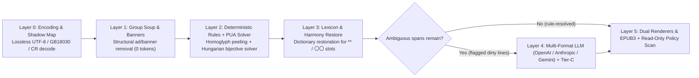

[简体中文](README.md) | [English](README.en.md)

# novel-wash

> A precision-first, cost-aware, auditable pipeline for Chinese web-novel de-poisoning, PUA font-cipher solving, EPUB archive repair/packaging, and read-only policy/omission scanning.

**novel-wash** cleans anti-scraping watermarks and encoding/structural corruption in Chinese web novels—channel/group banners, zero-width invisible characters, math/Cyrillic/Greek/circled homoglyph noise, `***`/`〇〇` censorship masks, Private Use Area (PUA) font ciphers, mixed UTF-8/GB18030 files, and malformed EPUB XML—while prioritizing deterministic rules and guarding legitimate prose punctuation.

---

## Key Features

- **Zero-Config Setup & Multi-Format Support**: Works out of the box with just your own `Base URL` + `API Key`. Natively supports **OpenAI Chat Completions** (OpenAI, DeepSeek, GLM, MiniMax, Qwen, OpenRouter, Ollama, OneAPI/NewAPI, etc.), **Anthropic Messages** (Claude), and **Google Gemini** (`generateContent` REST)—without requiring a `models.json` file or pre-registering custom model names.
- **Deterministic First, Graded Routing**: `triage` classifies files into seven explicit grades (`clean`, `encoding_only`, `moderate`, `heavy_soup`, `heavy_inline`, `heavy_soup_block`, `pua_cipher`). Run `--no-model` for strictly offline deterministic cleaning (`0 tokens`).
- **Constrained Binary Indexing & Fail-Closed Edit Log**: LLMs never rewrite text freely; they emit indexed binary decisions (`{"L12": {"del": [1, 3], "keep": [2]}}`). Every character-level `EditOp` must clear bounds checks, paired-dialogue protection, chapter-heading guards, and shadow-text replay verification.
- **Cross-Family Tier-C Consensus Gate**: Everyday high-frequency Simplified CJK characters cannot be deleted by a single model alone; cross-family verification can be configured (e.g., `minimax` + `glm`), and any unconfirmed/disputed entries fall back safely into `review_queue` (`status="review"`).
- **Pooled Routing, Self-Healing Circuit Breaker & `doctor`**: Per-provider concurrency/RPM rate limiting, token-owned half-open probe isolation, adaptive HTTP 429/529 backoff, and policy-refusal failover + recursive batch splitting. Includes `novel-wash doctor` for one-command endpoint and format verification.
- **PUA Font-Cipher Solver**: 4-pass paragraph context solver + global Jieba bigram Hungarian bipartite polish with low-evidence gating (uncertain entries stay excluded from approved edits). Cached maps verify both **codepoint set and `source_fingerprint`**.
- **EPUB3 Packaging & Repair**: Detects numbered chapter schemes and inline TOCs (with median line/character-gap guards), strictly validates raw XML/encoding declarations, and strips Telegram promo blocks while preserving entity-encoded dialogue.
- **Read-Only Policy & Fadeout Scanner**: Zero-mutation, `0-token` `scan-policy` command flags political sensitivity samples for human screening and highlights potential intimate fadeout/omission passages.
- **Dual-Edition Outputs**: Produces compact `reader.txt`, strictly line-aligned `ai.txt`, validated EPUB3 `.epub`, and full `edit_log.json`.

---

## Privacy & Operating Modes

- **Model-Enabled Mode**: Sends only localized excerpts to your configured API endpoint: (1) flagged ambiguous inline lines with short surrounding context windows (plus mined proper-noun lists); (2) when PUA font cipher solving runs, up to 16 sampled paragraph blocks, per-codepoint hole-filling and verification snippets (up to 5 `<=120`-char contexts per codepoint), plus up to two ~2,200-character opening continuous narrative slices for Pass-4 Round-3 contextual polish (which may include lines without PUA codepoints as surrounding context); and (3) when opt-in `--harmony-llm` is enabled, slot-marked (`⟦SLOTk⟧`) lines plus up to 60 characters of the preceding line.
- **Strictly Offline Mode (`--no-model`, `triage`, `epub-check`, `scan-policy`)**: Performs zero network calls and keeps all text strictly local.

---

## Layered Architecture



---

## Approximate Token Consumption & Breakdown (Historical Corpus Measurements)

> The figures below come from separate historical measurements on a local **21-TXT (`1,243,253` total lines) + 3-EPUB** corpus across tuning and re-runs. Actual token volume varies with each novel's pollution profile.

### Historical Corpus Benchmarks

- **21-TXT Historical Run (`1,243,253` lines total)**:
  - Deterministic/rule passes cleared `4,205` ad/soup lines, `25,336` inline pre-edits, and `273` harmony slot fills (`67,800` total approved edits across all layers);
  - **`5,479` lines (`0.44%` of lines in that corpus)** entered Layer 4 primary LLM review, and **`4,237` lines** entered Tier-C cross-family double-check.
- **Measured 7-Book Heavy Concurrent Re-Wash Batch** (`395` API calls):
  - **`742.7K` prompt tokens** (including `46.8K` prefix-cached) + **`262.3K` completion tokens** (including `106.8K` `reasoning_tokens`) = **`¥0.1689` RMB** total.
- **Cumulative Multi-Round Development Spend across All 24 Books**: `¥1.7747` RMB during v2 quality-fix iterations (`¥2.4073` RMB including earlier baseline rounds 1–9).

### Approximate Per-Book Token & Cost Guide

| Pollution Profile | Lines Sent to LLM | Approx. Input Tokens | Approx. Output Tokens | Approx. Cost / Book (Flash) | Notes |
|---|---:|---:|---:|---:|---|
| **`clean` / clean proofread** | `0` | `0` | `0` | **`¥0`** | Handled by rules or `--no-model` |
| **Light / medium watermarks** | `~100 – 300` | `~15K – 60K` | `~10K – 45K` | **`¥0.005 – ¥0.03`** | Compact JSON index replies (`<= 16` lines/batch) |
| **Heavy Yueyi / mixed-script novel** | `~600 – 1,000` | `~150K – 300K` | `~150K – 300K`* | **`¥0.05 – ¥0.15`** | Includes Tier-C checks & prefix caching |
| **PUA custom-font cipher novel** | `~50 – 300` codepoints | `~80K – 200K` | `~40K – 120K` | **`¥0.02 – ¥0.08`** | Exact-source re-runs hit cache at `0 tokens` |

> \* **Note**: Reasoning-enabled Flash models (`minimax-m3.1-flash`, `glm-5.3-flash`) allocate a large fraction of completion tokens to `reasoning_tokens`; non-reasoning Flash routes (`deepseek-v4.1-flash-1017`) emit much smaller JSON-only completions.

### Where Do Tokens Go?

1. **Layer 4 Primary Batched Classification** (primary consumer): Up to `16` dirty lines per request, prefix-caching the prompt + proper-noun allowlist.
2. **Layer 4 Tier-C Cross-Family Double-Check**: Only runs when the primary model proposes deleting everyday CJK characters, trading extra review calls and occasional `review_queue` deferrals for fewer false deletions.
3. **Thinking-Model `reasoning_tokens`**: Accounts for `106.8K / 262.3K` (`~40.7%`) in the 7-book heavy batch above.
4. **PUA Cipher Solver Passes 1–4**: Only runs on novels containing `U+E000–U+F8FF` cipher text; cached per codepoint set & `source_fingerprint`.
5. **Strictly `0-Token` Stages**: Layer 0 decoding, Layers 1–3 rule passes, EPUB3 packaging, downloaded EPUB XML/Telegram repair, and `scan-policy` scanning never invoke any LLM.

---

## Recommended Models & Historical M0 Blind Benchmark

The models below are tested presets that performed well in our [M0 benchmark report](benchmarks/m0_report.md) (28 mixed sample lines + 16 hard negative controls), **not hard requirements**—you can pass any custom OpenAI-compatible, Anthropic, Gemini, or local Ollama model name via `.env` or `--primary`/`--secondary`.

- **Single models**: `glm-5.3-flash` achieved the highest single F1 (`0.9741`, `P=0.9657 / R=0.9826`, `6` FP); `deepseek-v4.1-flash-1017` reached the highest recall (`R=0.9942`) with `38` false positives on common characters; `minimax-m3.1-flash` scored `P=0.9583 / F1=0.9471 / FP=7`.
- **Cross-family Tier-C trade-off**: Pairing `minimax-m3.1-flash + glm-5.3-flash` raised precision from `0.9583` to **`0.9817` with `3` false positives remaining** (F1 `0.9583`, `4` disagreements deferred to review), while `deepseek + glm` held `0.9741` F1 with `34` items routed to review.

| Role | Tested Reference Models | Notes |
|---|---|---|
| **Primary Route** | `minimax-m3.1-flash` | High stability, low false-positive rate, high tolerance for romance/adult web fiction |
| **Cross-Family Secondary** | `glm-5.3-flash` | Strong precision (`0.9657`), pairs cleanly across families with MiniMax or DeepSeek |
| **Fast / Low-Censorship Backup** | `deepseek-v4.1-flash-1017` / `deepseek-v4.1-flash` | Fast non-reasoning JSON output, highest recall, designed to be paired with Tier-C |
| **Alternative Fallback** | `hy4-preview` / `hy3` | Hunyuan-family secondary/fallback options |

---

## Quick Start

### 1. Install (Python >= 3.10)

```bash
git clone https://github.com/xzbdqian10nian/novel-wash.git
cd novel-wash
python3 -m venv .venv
source .venv/bin/activate
pip install -e ".[dev]"
```

### 2. Try the Offline Sample Without Any API Key

```bash
novel-wash triage examples/sample_polluted.txt
novel-wash wash examples/sample_polluted.txt --no-model --out output
```

### 3. Bring Your Own API Key (Zero-Config `.env` or CLI Flags)

Option A — copy `.env.example` to `.env` and fill in your own endpoint & key (no `models.json` required):

```bash
cp .env.example .env
```

```env
# Any OpenAI-compatible, Anthropic, Gemini, or Ollama endpoint works; https://api.openai.com/v1 defaults to gpt-4o-mini
NOVEL_WASH_BASE_URL=https://api.openai.com/v1
NOVEL_WASH_API_KEY=your-api-key-here
# Optional: openai | anthropic | gemini (auto-inferred from URL when omitted)
# NOVEL_WASH_API_FORMAT=openai
# Optional: primary model (required for custom/third-party gateways unless using config/models.json)
# NOVEL_WASH_PRIMARY_MODEL=deepseek-chat
# Optional: cross-family Tier-C model (set to 'none' or leave empty for single-model mode)
# NOVEL_WASH_SECONDARY_MODEL=glm-5.3-flash
```

Option B — pass credentials directly via CLI flags:

```bash
novel-wash doctor --base-url https://api.anthropic.com --api-key "$ANTHROPIC_API_KEY" --primary claude-sonnet-4-5
novel-wash wash /path/to/novel.txt --base-url https://generativelanguage.googleapis.com --api-key "$GEMINI_API_KEY" --primary gemini-2.5-flash --out output
```

Option C (Advanced multi-provider setup): copy `config/models.example.json` to `config/models.json` to mix OpenAI-compatible gateways, Anthropic, Gemini, local Ollama, and failover pools:

```bash
cp config/models.example.json config/models.json
# Optional: customize local policy scan lexicon
cp config/policy_terms.example.json config/policy_terms.json
```

> `.env`, `config/models.json`, `config/policy_terms.json`, and `config/corpus.json` are all gitignored.

### 4. Common Commands

```bash
# 1) Verify API endpoint, format adapter, and key connectivity
novel-wash doctor

# 2) Encoding & pollution triage (0 tokens, offline)
novel-wash triage /path/to/novel.txt

# 3) Wash a novel into AI/Reader TXTs + EPUB3 + edit_log.json
novel-wash wash /path/to/novel.txt --out output
#    Enable multi-route failover pools when defined in config/models.json:
novel-wash wash /path/to/novel.txt --use-pools --out output
#    Strictly local offline rule-only cleaning (0 tokens, no network calls):
novel-wash wash /path/to/novel.txt --no-model --out output

# 4) Repair broken EPUB XML/encoding & strip Telegram banners (0 tokens, offline)
novel-wash epub-check /path/to/broken.epub --strip-telegram --out output/epub_fixed

# 5) Read-only political risk & fadeout scan across TXT/EPUB (0 tokens, offline)
novel-wash scan-policy output/reader/*.reader.txt output/epub_fixed/*.fixed.epub --out output/policy_report.json

# 6) Batch wash using a corpus manifest (see config/corpus.example.json)
python scripts/wash_corpus.py --manifest config/corpus.example.json --strip-telegram
```

### 5. M0 Benchmark Tools (Optional)

The checked-in [benchmarks/m0_report.md](benchmarks/m0_report.md) and [benchmarks/m0_results.json](benchmarks/m0_results.json) document historical benchmark numbers without redistributing novel text. Keep private manifests and spec files outside the repo:

```bash
# Emit a non-copyrighted synthetic smoke gold file (defaults to gitignored output/benchmarks/synthetic_gold.jsonl):
python benchmarks/build_gold.py --write-synthetic-demo
# Or build & evaluate from your own manifest + external gold spec JSON (pass --force to overwrite existing outputs):
python benchmarks/build_gold.py --manifest /path/to/private_corpus.json --specs /path/to/private_specs.json --out output/benchmarks/gold_set.jsonl
# Fresh reports default to gitignored output/benchmarks/ without overwriting tracked historical results:
python benchmarks/run_m0.py --manifest /path/to/private_corpus.json --gold output/benchmarks/gold_set.jsonl
```

---

## Tests

```bash
pytest -v
```

All core synthetic & unit tests run offline with zero local corpus fixtures or live API keys (`70 collected`: `67 passed`, `3` env-gated optional local corpus tests skipped when unset, `0 failed`).

## License

Released under the [MIT License](LICENSE) (`Copyright (c) 2026 Tank`). Use this tool only on texts for which you hold legal rights or personal-archiving permissions.
