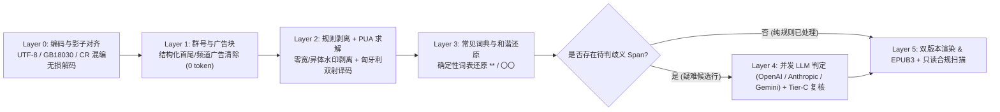

[简体中文](README.md) | [English](README.en.md)

# novel-wash

> 高精度、低成本、可审计的中文网文去投毒清洗、PUA 字体密码破译、EPUB 修复打包与只读合规扫描管线。

**novel-wash** 针对盗版/防盗污染中文网文（群号广告、零宽不可见字符、数学粗斜体/西里尔/希腊/圈号字符替换、`***`/`〇〇` 和谐占位、自定义字体 PUA 映射、UTF-8/GB18030 混编、畸形 EPUB XML）提供一套**纯规则优先 + 疑难行受限进模型 + 跨家族双模型复核门禁**的批量清洗管线，尽可能保护原书作者正文与标点。

---

## 核心特性

- **开箱即用零配置 & 多协议原生支持**：只需填自己的 `Base URL` + `API Key` 即可运行，支持 **OpenAI Chat Completions**（覆盖 OpenAI、DeepSeek、智谱 GLM、MiniMax、通义千问、OpenRouter、Ollama、OneAPI/NewAPI 等兼容网关）、**Anthropic Messages**（原生 Claude）与 **Google Gemini**（原生 `generateContent` REST）；不建 `config/models.json` 也能直接跑，任何自定义模型名即插即用。
- **确定性规则优先，按分级按需调用模型**：`triage` 自动给出 7 种健康分级：`clean`、`encoding_only`、`moderate`、`heavy_soup`、`heavy_inline`、`heavy_soup_block`、`pua_cipher`；可用 `--no-model` 强制纯离线规则清洗（严格 `0 token`）。
- **受限二分类 + 不可变账本（Fail-Closed）**：模型不能自由重写正文，只能输出 `{"L行号": {"del": [...], "keep": [...]}}` 索引决策；所有字符级 `EditOp` 均经过边界、配对对话引号、章节标题及不可变影子文本回放校验。
- **跨家族 Tier-C 复核门禁**：常用高频简体字（`一/二/三/是/就/衣/尔` 等）严禁单模型直接删去，支持配置跨家族双模型复核（如 `minimax` + `glm`）；未配置双模型或存在分歧的条目自动拦截入 `review_queue`（`status="review"`）等待人工确认。
- **并发路由、自愈熔断与连通性自检**：支持按 provider 限流/并发调度，具备半开探针熔断、截断重试换路、HTTP 429/529 自适应降速，以及内容审核拦截自动切换低审核备份并二分拆批隔离；内置 `novel-wash doctor` 一键验证接口连通性与协议适配。
- **PUA 私有区密码求解器**：四阶段上下文迭代 + 全局 Jieba Bigram 匈牙利二分匹配 + 低证据门控（低证据字保留 `uncertain`、不发出 `approved` 改动），缓存同时校验**码点指纹与源文指纹（`source_fingerprint`）**（同一源文重跑直接 `0 token` 命中缓存；不同书即使用同款字体也不会错用他人码表）。
- **EPUB3 打包与残缺档案修复**：支持编号章节与行内目录识别（带中位数行距/字距守卫）、严格字节解码与 XML/编码声明修复，以及实体解码保护下的 Telegram 引流块结构化剥离。
- **只读涉政扫描 & 拉灯提示**：完全不改动正文，`scan-policy` 按分级词库输出涉政样本定位，并可选提示疑似「亲密情节拉灯/省略」段落。
- **双版本清洁输出**：输出紧凑阅读版 `reader.txt`、严格行号对齐的 `ai.txt`、EPUB3 `.epub` 与可追溯 `edit_log.json`。

---

## 数据隐私与运行模式

- **在线模型模式**（默认启用模型时）：仅发送检测出的局部内容给配置的 API 服务商，包括：（1）行内歧义候选行及其前后极短上下文窗口（连同少量小说专名参考词表）；（2）当文本含 PUA 私有区密文并启用求解时，还会发送最多 16 段抽样正文段落、逐码点补洞与复核用的上下文片段（每码点最多 5 条 `<=120` 字片段），以及 Pass-4 Round-3 连贯润色用的约两段各 ~2,200 字开篇正文切片（可能包含不含 PUA 码点、用于提供语境的普通正文行）；（3）如显式开启 `--harmony-llm`，还会发送含 `⟦SLOTk⟧` 槽位标记的待还原行及其前一行最多 60 字上下文。
- **纯本地离线模式（`--no-model` / `triage` / `epub-check` / `scan-policy`）**：完全不发出任何网络请求，适合严格本地私密处理。

---

## 分层清洗架构



---

## 大致 Token 消耗与去向拆解（基于历史 24 本书库实测）

> 以下数字均来自一次包含 **21 本本地 TXT（共 `1,243,253` 行）与 3 本破损 EPUB** 的历史全库清洗实测（包含多轮调参、重跑与模型对比实验），不同书库的实际用量取决于具体污染比例。

### 历史全库实测基准

- **21 本 TXT（`1,243,253` 行）历史统计**：
  - 仅规则层完成 `4,205` 行广告清除、`25,336` 次字符预剥离与 `273` 次和谐还原（全流程合计核准编辑 `67,800` 处）；
  - 该书库中进入 Layer 4 主模型判定的为 **`5,479` 行（占该批总行数的 `0.44%`）**，其中触发 **Tier-C 跨家族复核** 的为 **`4,237` 行**。
- **7 本重度污染小说并发混洗批次实测账本**（395 次请求）：
  - 总输入约 **`742.7K` Prompt Tokens**（含 Prefix Cache 命中 `46.8K`）；
  - 总输出约 **`262.3K` Completion Tokens**（其中推理模型思考占用 `106.8K`）；
  - 当次合计实测费用：**`¥0.1689` RMB**。
- **24 本全库多轮开发累计消费**：质量修复阶段多轮实测合计 `¥1.7747` RMB（含更早期基线 Rounds 1–9 累计约 `¥2.4073` RMB）。

### 单本小说大致 Token 与费用估测

| 小说污染画像 | 进入 LLM 行数估算 | 大致 Input Tokens | 大致 Output Tokens | 参考费用 (Flash) | 说明 |
|---|---:|---:|---:|---:|---|
| **`clean` / 无水印校对版** | `0` 行 | `0` | `0` | **`¥0`** | 自动走纯规则或 `--no-model` |
| **轻 / 中度零星水印** | `~100 – 300` 行 | `~15K – 60K` | `~10K – 45K` | **`¥0.005 – ¥0.03`** | 按最多 16 行/批输出紧凑 JSON |
| **重度月漪 / 多混编长篇** | `~600 – 1,000` 行 | `~150K – 300K` | `~150K – 300K`* | **`¥0.05 – ¥0.15`** | 含 Tier-C 双审与 Prefix Cache 复用 |
| **PUA 私有字体密文本** | 解密 `~50 – 300` 码点 | `~80K – 200K` | `~40K – 120K` | **`¥0.02 – ¥0.08`** | 同源文件重跑 `0 token` 命中缓存 |

> \* **注**：使用带思考链的模型（如 `minimax-m3.1-flash`、`glm-5.3-flash`）时，思考 Token（`reasoning_tokens`）会显著推高 Completion Tokens 总量；若选用无思考直出 JSON 的快速模型（如 `deepseek-v4.1-flash-1017`），Completion Tokens 可大幅降低。

### Token 主要消耗点

1. **Layer 4 主模型分批判定（最主要来源）**：每批最多 `16` 行，系统提示词与专名白名单享 Prefix Cache，模型只返回 `{"L行号":{"del":[...]}}`。
2. **Layer 4 跨家族 Tier-C 复核（次要来源）**：仅针对主模型建议删除日常高频汉字的条目发起第二家族模型复核，避免高发正常字被直接删错。
3. **推理模型思考开销（`reasoning_tokens`）**：如上 7 本批次实测中，`106.8K / 262.3K`（约 `40.7%`）来自思维链，换取极低误删率。
4. **PUA 字体密码求解 Pass 1–4**：仅在书内出现大段 `U+E000–U+F8FF` 密文时触发一次；结果按源指纹落盘缓存。
5. **零 Token 环节**：Layer 0 编码修复、Layer 1–3 广告/规则清洗、EPUB3 打包、既有 EPUB 坏 XML/Telegram 横幅清理、`scan-policy` 均完全离线、消耗 **`0 token`**。

---

## 推荐模型与历史 M0 盲测权衡

以下模型为开发实测表现优秀的**推荐参考配置**（并非强制要求；你可以替换为任意 OpenAI 兼容 / Anthropic / Gemini 模型名，如 `gpt-4o-mini`、`deepseek-chat`、`claude-sonnet-4-5`、`gemini-2.5-flash` 或本地 Ollama 模型）。数据出自历史私有金标盲测报告 [M0 报告](benchmarks/m0_report.md)（共 28 行混合真实样本 + 16 组干净难负例）：

- 单模表现上，`glm-5.3-flash` 取得最高单模 F1（`0.9741`，`P=0.9657 / R=0.9826`，误删 `6` 处）；`deepseek-v4.1-flash-1017` 召回最高（`R=0.9942`）但单模会误删正常常用字（`FP=38`）；`minimax-m3.1-flash` 单模 `P=0.9583 / F1=0.9471 / FP=7`。
- 启用 **Tier-C 跨家族复核**后，`minimax-m3.1-flash + glm-5.3-flash` 将误删进一步压低到 **`3` 处（`FP=3`），Precision 提升至 `0.9817`**（F1 为 `0.9583`，另有 `4` 处分歧被拦入审校队列）；`deepseek + glm` 则保留更高召回与高 F1（`0.9741`，`34` 处拦截进队列）。

| 角色定位 | 推荐参考模型 | 说明 |
|---|---|---|
| **高稳主力 (`primary`)** | `minimax-m3.1-flash` | 稳定高精、对言情/成人描写拒审率较低 |
| **跨家族复核 (`secondary`)** | `glm-5.3-flash` | 精确率极高，与 MiniMax / DeepSeek 跨家族互补 |
| **高性价比主力 / 低审核备选** | `deepseek-v4.1-flash-1017` / `deepseek-v4.1-flash` | 响应快、无思维链冗余，建议配合 Tier-C 门禁或审校队列 |
| **异构备选** | `hy4-preview` / `hy3` | 混元家族补充备选 |

---

## 快速开始

### 1. 安装（Python >= 3.10）

```bash
git clone https://github.com/xzbdqian10nian/novel-wash.git
cd novel-wash
python3 -m venv .venv
source .venv/bin/activate
pip install -e ".[dev]"
```

### 2. 免 API Key 先体验离线样例

仓库内置了一个原创模拟污染样本 [examples/sample_polluted.txt](examples/sample_polluted.txt)，无需配置任何密钥即可立即实测离线规则清洗：

```bash
novel-wash triage examples/sample_polluted.txt
novel-wash wash examples/sample_polluted.txt --no-model --out output
```

### 3. 配置你自己的 API Key（极简零配置，无需手写 `models.json`）

方式 A — 复制 `.env.example` 为 `.env`，直接填入你自己的网关地址、Key 与想用的模型名：

```bash
cp .env.example .env
```

```env
# 任何 OpenAI 兼容、Anthropic、Gemini 或 Ollama 地址均可；只填 https://api.openai.com/v1 + Key 会自动默认 gpt-4o-mini
NOVEL_WASH_BASE_URL=https://api.openai.com/v1
NOVEL_WASH_API_KEY=your-api-key-here
# 可选：openai | anthropic | gemini（不填时按域名自动推断）
# NOVEL_WASH_API_FORMAT=openai
# 可选：主模型（若使用自定义第三方网关请显式指定）
# NOVEL_WASH_PRIMARY_MODEL=deepseek-chat
# 可选：跨家族 Tier-C 复核模型（留空或 none 表示单模型运行）
# NOVEL_WASH_SECONDARY_MODEL=glm-5.3-flash
```

方式 B — 不创建任何配置文件，直接在命令行传入：

```bash
novel-wash doctor --base-url https://api.anthropic.com --api-key "$ANTHROPIC_API_KEY" --primary claude-sonnet-4-5
novel-wash wash /path/to/novel.txt --base-url https://generativelanguage.googleapis.com --api-key "$GEMINI_API_KEY" --primary gemini-2.5-flash --out output
```

方式 C（进阶多服务商混用）：如需同时配置 OpenAI 兼容网关、Anthropic 官方、Gemini 官方、本地 Ollama 或多路由故障转移池，可复制：

```bash
cp config/models.example.json config/models.json
# 可选：自定义本地敏感词库
cp config/policy_terms.example.json config/policy_terms.json
```

> `.env`、`config/models.json`、`config/policy_terms.json`、`config/corpus.json` 均已加入 `.gitignore`，不会意外提交。

### 4. 常用命令

```bash
# 1) 一键检查 API 地址、协议适配与连通性
novel-wash doctor

# 2) 快速编码探测与污染分级（0 token，纯离线）
novel-wash triage /path/to/novel.txt

# 3) 清洗小说并输出双版本 TXT + EPUB3 + 审计日志
novel-wash wash /path/to/novel.txt --out output
#    如已在 config/models.json 配置 pools，可开启高可用故障转移池：
novel-wash wash /path/to/novel.txt --use-pools --out output
#    纯本地零成本离线清洗（不发送任何网络请求）：
novel-wash wash /path/to/novel.txt --no-model --out output

# 4) 修复损坏 EPUB 并剥离内嵌 Telegram 引流横幅（0 token，纯离线）
novel-wash epub-check /path/to/broken.epub --strip-telegram --out output/epub_fixed

# 5) 只读涉政风险 & 拉灯省略提示扫描（0 token，支持 TXT/EPUB）
novel-wash scan-policy output/reader/*.reader.txt output/epub_fixed/*.fixed.epub --out output/policy_report.json

# 6) 批量处理整批书库（参考 config/corpus.example.json）
python scripts/wash_corpus.py --manifest config/corpus.example.json --strip-telegram
```

### 5. M0 基准脚本说明（可选）

仓库附带的 [benchmarks/m0_report.md](benchmarks/m0_report.md) 与 [benchmarks/m0_results.json](benchmarks/m0_results.json) 为历史实验记录，**不包含任何小说版权原文**。如需在本地自建评测集（建议将私有清单与 specs 放在仓库外）：

```bash
# 先生成一份完全离线、无版权风险的合成演示金标（默认写入已忽略的 output/benchmarks/synthetic_gold.jsonl）：
python benchmarks/build_gold.py --write-synthetic-demo
# 或配合私有 corpus manifest 与私有 specs 文件生成（已存在输出文件时需加 --force 覆盖）：
python benchmarks/build_gold.py --manifest /path/to/private_corpus.json --specs /path/to/private_specs.json --out output/benchmarks/gold_set.jsonl
# 运行评测（结果默认输出到已忽略的 output/benchmarks/，不会污染追踪中的历史报告）：
python benchmarks/run_m0.py --manifest /path/to/private_corpus.json --gold output/benchmarks/gold_set.jsonl
```

---

## 测试

```bash
pytest -v
```

- 无需任何私有小说文件或真实 API Key，全套核心测试直接离线跑通（`70 collected`：`67 passed`，`3` 项需本地环境变量开启的可选回归测试自动 `skipped`，`0 failed`）。

## 开源协议

基于 [MIT License](LICENSE) 发布（`Copyright (c) 2026 Tank`）。**请仅对您拥有合法版权或个人备份整理权限的文本使用本工具。**
